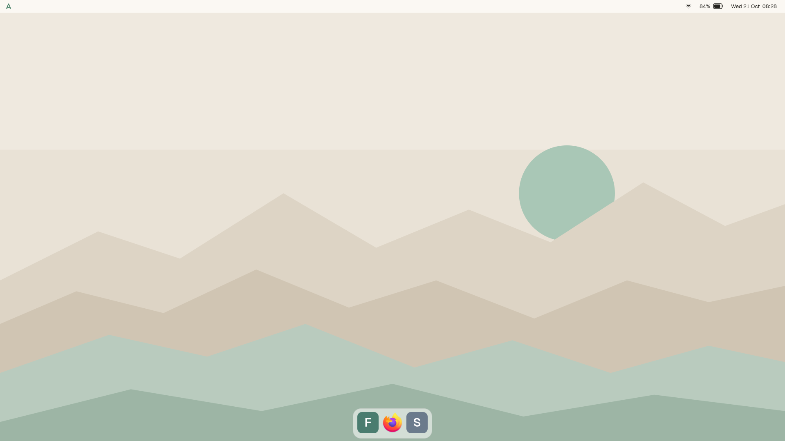
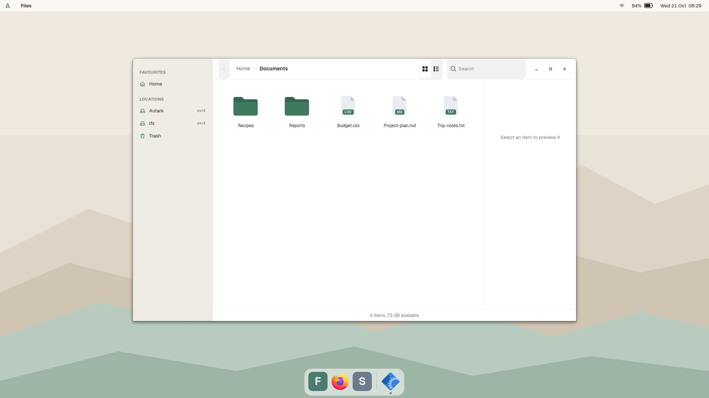
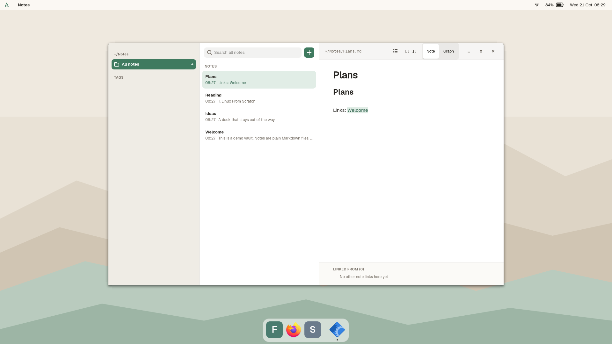
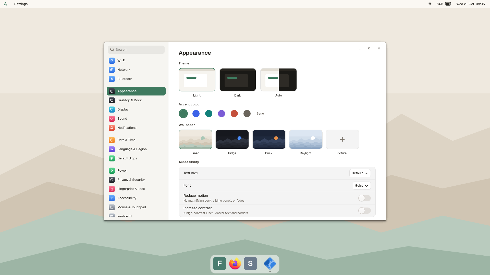
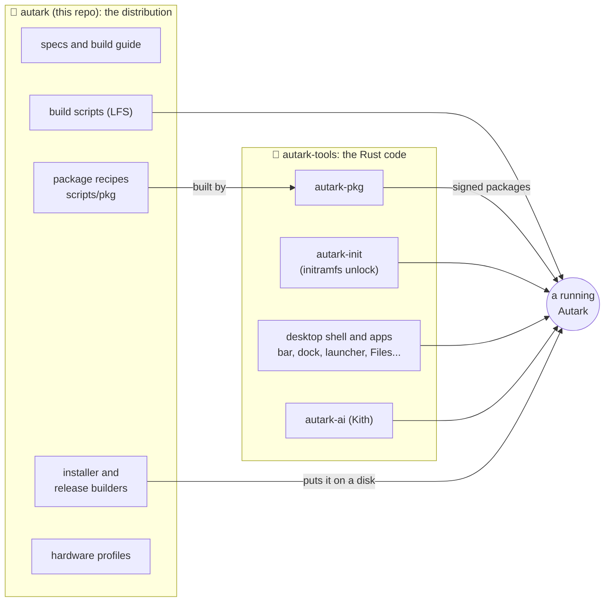
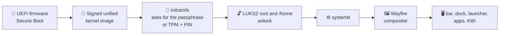
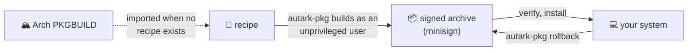

<h1 align="center">Autark</h1>

<p align="center">
  A Linux distribution built from scratch: encrypted and Secure Boot first,<br>
  with a Mac-like desktop and a local-first AI assistant on top.
</p>

<p align="center">
  <a href="LICENSE-MIT"></a>
  
  
  <a href="https://github.com/Seuketchi/autark/stargazers"></a>
  <a href="https://github.com/Seuketchi/autark/commits/main"></a>
</p>

The name comes from *autarky*, meaning self-sufficient: every package chosen and built from source, every decision made by its owner.

## ✨ What it is

| | |
| --- | --- |
| 🔒 **Security first** | The whole disk is encrypted (LUKS2) and unlocks with a passphrase or TPM plus PIN. There is no bootloader: the firmware starts a signed kernel image directly, signed with a key made on your own machine. Packages are built with stack protection, `_FORTIFY_SOURCE=3`, CET, PIE and full RELRO. A default-drop firewall (nftables) refuses every incoming connection, with no exceptions until you add them. |
| ⚡ **Efficient and fast** | `-march=x86-64-v3 -O2` builds, zram swap, a kernel trimmed or generic by profile, and power settings that follow battery and charger. |
| 🖥️ **A desktop you can read** | [Wayfire](https://github.com/WayfireWM/wayfire) with a shell written in GTK4 and Rust: bar, dock, launcher, notifications, lock screen, Files, Notes, Settings and more. It lives in [`autark-tools`](https://github.com/Seuketchi/autark-tools). |
| 🤖 **Local-first AI** | Kith, an assistant that runs on [Ollama](https://ollama.com) on your laptop. It is off until you turn it on, reads only files you name, and logs every call. An optional cloud engine, Jev, can make fast typed decisions; it is off unless you switch it on per feature. |
| 📦 **Signed packages** | `autark-pkg` builds recipes into signed archives, installs and rolls back, and can import a recipe from Arch Linux when none exists. |
| 🧰 **An installer** | A USB image (or a Ventoy stick) that erases one blank disk you choose and sets up the encrypted system. |

## 🖼️ What it looks like

Real captures of the desktop, taken in a throwaway demo session with sample files (no personal data).

<p align="center">
  
  
</p>
<p align="center">
  
  
</p>

## 🧩 How it works

Autark is two repositories that work together.



- **This repo** holds what makes a system: the specs, the step-by-step LFS build, the package recipes, the hardware profiles, the installer and the release builders.
- **[`autark-tools`](https://github.com/Seuketchi/autark-tools)** holds the Rust programs that run on it. They are kept apart so other Linux systems can use the desktop tools too (the package manager and initramfs are Autark-only or need LUKS2 and a TPM).

### From power button to desktop



There is no bootloader menu. The previous kernel image is kept as a fallback boot entry. The key that signs images is made on your machine by the installer and never leaves it.

### Installing and updating software



## ⚖️ How it compares

Autark is not trying to replace the big distributions. It makes a different set of choices, and this table shows them next to what the common distros typically do by default. Defaults change between releases, so check the distro you use.

| | **Autark** | Ubuntu / Fedora | Arch | NixOS | Linux From Scratch |
| --- | --- | --- | --- | --- | --- |
| **Packages** | Built from source from recipes, installed as signed archives, with rollback | Prebuilt binary packages (apt, dnf) | Prebuilt binary packages (pacman) | Declarative, from the Nix store | You compile everything by hand, no package manager |
| **Install** | Installer image that sets up the encrypted system (early, qemu-tested) | Graphical installer | Manual, from a shell | Installer plus a config file you write | Weeks of manual steps from a book |
| **Disk encryption** | On by design: LUKS2 for root and `/home`, TPM plus PIN planned after the first boot | An option you choose at install | You set it up yourself | You set it up in your config | You set it up yourself |
| **Bootloader** | None: the firmware starts a signed kernel image | GRUB | Your choice (GRUB, systemd-boot...) | systemd-boot or GRUB | Your choice |
| **Secure Boot** | Your own key, made on your machine | Works out of the box through a Microsoft-signed shim | Manual setup | Needs an extra project (Lanzaboote) | Manual setup |
| **Desktop** | Its own shell (Wayfire, GTK4 and Rust), Mac-like | GNOME (KDE and others available) | Whatever you install | Whatever you configure | Whatever you build |
| **Init** | systemd | systemd | systemd | systemd | systemd (or sysvinit), your choice of book |
| **AI** | Local-first assistant, off by default | None built in | None built in | None built in | None |
| **Maturity** | One maintainer, one laptop, experimental | Large teams, years of releases | Large community, rolling | Large community | A teaching project |

### 🤔 Should you use it?

- **Use Fedora or Ubuntu** if you want something that works today on any hardware, with security updates from a big team.
- **Use Arch or NixOS** if you want to assemble your own system and are happy to maintain it.
- **Try Autark** if you want to know what every part of your system is and how it was built, with disk encryption and Secure Boot as the starting point and not an add-on, and you are fine with something early that may break.

What Autark gives up today: hardware support is thin (the generic profile is largely untested), there is no signed release yet, updates come from building packages yourself, and one person maintains it.

## 🚀 Install

> **There is no release to download yet.** The installer works from start to finish in a virtual machine, but it has not been tried on a second real computer, and the release signing key is not made, so signed images don't exist. This section shows what installing looks like and how to try it yourself today.

**The installer erases a whole disk.** It only works on a blank disk you name, and makes you type that name to confirm. Don't run it on a machine whose data you care about.

### Once a release is published

1. Download `autark-installer-<version>.img` (or the Ventoy files) and check its signature and checksum.
2. Write the image to a USB stick, or copy the `autark/` folder and `autark-installer.efi` to a [Ventoy](https://www.ventoy.net) stick's big partition and choose `autark-installer.efi` in its menu.
3. Boot it with Secure Boot **off** (the live image is unsigned).
4. In the live system, check the disks with `lsblk`, then run:

   ```sh
   autark-install --disk /dev/nvme0n1 \
     --rootfs /run/initramfs/live/autark/autark-rootfs-<version>.tar.zst \
     --pubkey /etc/autark/installer-release.pub \
     --hostname mylaptop --user me
   ```

   It asks for a disk passphrase and your password, partitions the disk (ESP, encrypted root, encrypted `/home`), unpacks the system, writes this machine's own files and builds the signed boot image.
5. After the first boot, enrol the Secure Boot key it printed (a step in your firmware's setup screen), turn Secure Boot on, then run `sudo autark-tpm-enroll` to add TPM plus PIN unlock and write down the recovery key.

Details, including what is still manual: [`docs/specs/installer.md`](docs/specs/installer.md).

### Try it in a virtual machine today

You need `qemu` with UEFI firmware and a rootfs built by [`scripts/make-rootfs.sh`](scripts/make-rootfs.sh) from a finished Autark system:

```sh
sudo scripts/make-installer-image.sh --rootfs autark-rootfs-0.1.tar.zst --version 0.1 --out autark-installer.img
scripts/qemu-test/install-test.sh autark-installer.img --disk test-disk.img      # boots the stick on a blank virtual disk
# inside the VM: autark-install --disk /dev/nvme0n1 ... --no-verify --cmdline-extra console=ttyS0,115200
scripts/qemu-test/install-test.sh autark-installer.img --disk test-disk.img --boot-disk    # boots the installed system
```

### Build it from source

Autark is built, not downloaded, for now: [`docs/specs/build-guide.md`](docs/specs/build-guide.md) takes a stock Ubuntu host to a running desktop, step by step (it takes days, mostly compiling). The finished system is then packaged with `make-rootfs.sh` and `make-installer-image.sh`, described in [`docs/specs/releasing.md`](docs/specs/releasing.md).

## 📊 Status

Experimental. Autark runs daily on its author's laptop (an MSI Cyborg 15), built by hand following the build guide. The installer works end to end in a virtual machine: it erases a blank disk, makes an encrypted install and the machine's own Secure Boot key, and the result boots and logs in.

| Works | Still manual, untested or missing |
| --- | --- |
| Encrypted install from a USB image, in qemu | Secure Boot enrolment and TPM unlock are steps after the install |
| Signed boot image, generic kernel with all firmware | No second real machine tried yet |
| Desktop shell, apps, package manager | No signed release or download yet |
| Ventoy layout (EFI file plus `autark/` folder) | Ventoy itself not tested; Secure Boot must be off |

The kernel and some scripts are tuned for the author's laptop; [`hardware/generic/`](hardware/generic/) is the profile for other hardware and is largely untested. See the [roadmap](docs/specs/roadmap.md).

## 📚 Documentation

| Path | What |
| --- | --- |
| [`docs/specs/decisions.md`](docs/specs/decisions.md) | What Autark is made of and why, plus the hardware standard |
| [`docs/specs/build-guide.md`](docs/specs/build-guide.md) | The build, step by step, from an Ubuntu host to a running desktop |
| [`docs/specs/installer.md`](docs/specs/installer.md) | The installer: what it does, the release files, installing from a USB stick or Ventoy |
| [`docs/specs/releasing.md`](docs/specs/releasing.md) | How a release is made and signed |
| [`docs/specs/customization.md`](docs/specs/customization.md) | Looks, rebindable shortcuts, bar and dock layout, window feel, launcher, sounds and wallpapers: how settings work and how others add to them |
| [`docs/specs/hub.md`](docs/specs/hub.md) | Autark Hub (planned): install and update software from a window, every download verified |
| [`docs/specs/maintenance.md`](docs/specs/maintenance.md) | Updates, rollback, A/B upgrades, health checks |
| [`docs/specs/roadmap.md`](docs/specs/roadmap.md) | Milestones and target dates, from host setup to daily driver |
| [`docs/specs/ai-layer.md`](docs/specs/ai-layer.md) | AI in the OS: Jev for fast decisions, Ollama for local generation |
| [`docs/specs/notes.md`](docs/specs/notes.md) | Autark Notes: Apple Notes feel, Obsidian files, links and graph |
| [`docs/specs/baseline.md`](docs/specs/baseline.md) | Today's Ubuntu measured, with fixes and Autark's target for each problem |
| [`design/`](design/) | Desktop design mockups: every screen, Kith, icons, logo and colours |
| [`hardware/`](hardware/) | Laptop profiles (kernel config, modules, devices, firmware) |
| [`scripts/`](scripts/) | The build scripts (`lfs/`), package recipes (`pkg/`), the installer and the release builders |

## 🤝 Contributing

Pull requests, issues and ideas are welcome (see [`CONTRIBUTING.md`](CONTRIBUTING.md); `main` is protected and every change goes through a pull request), especially reports from hardware other than the author's. Tell us the laptop model and what the installer or the boot did; `scripts/capture-hardware.sh <name>` records a laptop's profile. Since this is early software that touches disks and boot keys, read [`docs/specs/installer.md`](docs/specs/installer.md) before trying a real install.

## ⭐ Star history

<a href="https://star-history.com/#Seuketchi/autark&Date">
  
</a>

*(The chart is drawn by star-history.com when this page loads.)*

## 📄 Licence

Autark's own code, scripts and documents are licensed under either of [Apache License 2.0](LICENSE-APACHE) or [MIT licence](LICENSE-MIT), at your option. The software the recipes in `scripts/pkg/` build keeps its own licences.
